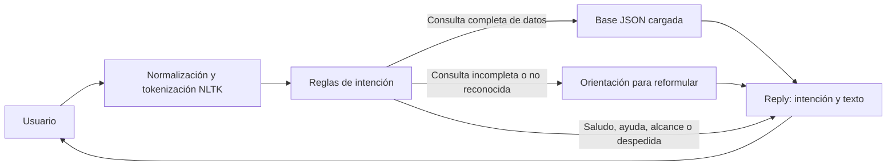
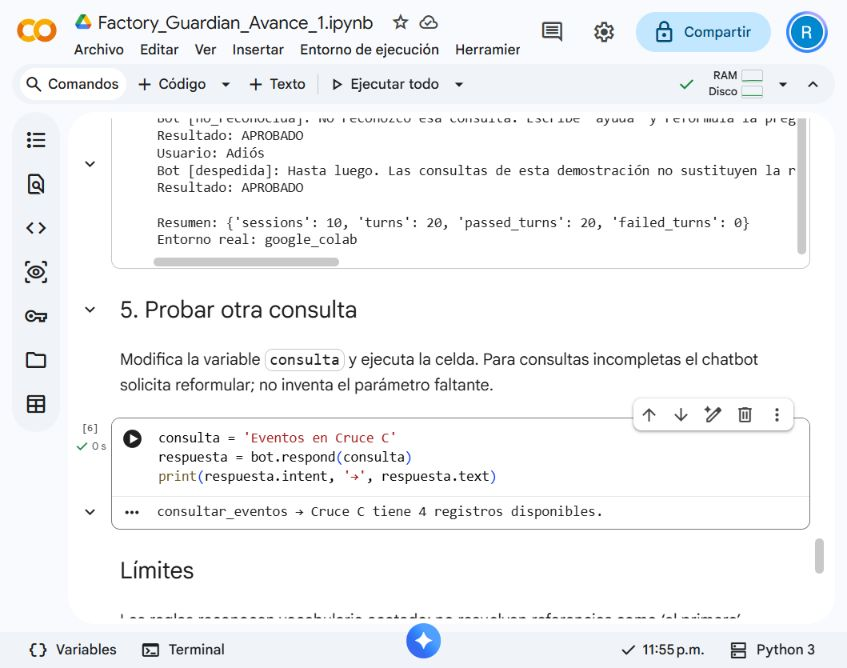

# Factory Guardian — Avance 1

Chatbot de consultas en Python 3.10+ que utiliza NLTK para tokenizar mensajes y reglas para identificar la consulta. Trabaja con cuatro registros ficticios sobre interacción entre peatones y montacargas y con una guía demostrativa.

La idea de Factory Guardian surgió de una propuesta de hackathon. Para este avance decidí concentrarme en la necesidad de un supervisor de recuperar antecedentes: consultar registros por zona, revisar su estado y encontrar una guía. Acoté el desarrollo a ese recorrido, de acuerdo con la consigna, antes de ampliar la plataforma.

Repositorio: [Factory-Guardian-Avance-1](https://github.com/rubenstrada/Factory-Guardian-Avance-1).

## Recorrer el proyecto

El reporte explica el problema, la metodología y las decisiones. La guía técnica reúne el funcionamiento del código y la forma de repetir las comprobaciones.

| Recurso | Contenido |
|---|---|
| [Reporte metodológico](docs/reporte.md) | Problema, alcance, metodología, interpretación y conclusiones. |
| [Guía técnica](docs/guia_tecnica.md) | Responsabilidades, funciones, reglas, datos y ejecución. |
| [Decisiones](docs/decisiones.md) | Cómo acoté y organicé el avance. |
| [Uso de IA](docs/uso_de_ia.md) | Mi participación y el apoyo recibido de Codex. |
| [Código fuente](src/factory_guardian/) | Chatbot, interfaz de terminal, evaluador y conocimiento. |
| [Evidencia completa](artifacts/) | Transcripciones, resultados de pruebas y comprobación del notebook. |

## Ejecutar desde la raíz

Con Python 3.10 o posterior:

```powershell
python -m pip install -e ".[dev]"
python -m factory_guardian.cli
```

Prueba `Eventos en Cruce C`, `Estado NM-001` o `Guía de Cruce C`. Las consultas son de solo lectura y cada mensaje se interpreta por separado. Si falta una zona o un ID, el chatbot solicita una pregunta completa. Para terminar la terminal, escribe `salir`.

## Usar desde Python

```python
from factory_guardian.bot import FactoryGuardianBot

bot = FactoryGuardianBot()
reply = bot.respond("ayuda")
print(reply.intent)
print(reply.text)
```

`respond` devuelve un objeto `Reply` con la intención identificada y el texto de respuesta.

## Arquitectura y flujo



La base se carga al crear el chatbot. NLTK tokeniza el texto sin descargar modelos; las reglas seleccionan una respuesta o consultan los registros del JSON. El detalle de las ocho intenciones está en la [guía técnica](docs/guia_tecnica.md#orden-de-las-reglas).

## Notebook y evidencia

El [notebook](notebooks/Factory_Guardian_Avance_1.ipynb) contiene el recorrido del prototipo y las diez conversaciones. Como se ve en la captura, el chatbot también funcionó en Google Colab: las diez conversaciones terminaron sin fallos.



Para repetir las conversaciones y las pruebas:

```powershell
python scripts/run_conversations.py
python -m pytest --junitxml=artifacts/test_results.xml
```

Las [diez transcripciones](artifacts/conversations.md) muestran preguntas, respuestas y resultados. Las [expectativas](tests/conversations.json) y las [salidas estructuradas](artifacts/conversations.json) permiten seguir cada comparación. El [resumen de verificación](artifacts/verification_summary.json) identifica los resultados y el entorno utilizado. La guía técnica incluye los comandos para [reconstruir el notebook](docs/guia_tecnica.md#ejecución-desde-la-raíz).

## Límites

Los registros y la guía son ficticios y sirven para demostrar el funcionamiento del chatbot. Las respuestas no sustituyen procedimientos de una planta real ni permiten evaluar una situación de seguridad.

El avance utiliza reglas y no aprende de las conversaciones. La visión por computadora, los modelos de lenguaje, RAG y las alertas quedan como posibilidades de evolución; no forman parte de esta implementación.

La idea y el alcance partieron de mí. Desarrollé esta entrega con asistencia de Codex en la implementación, las pruebas y la documentación. En la [nota de uso de IA](docs/uso_de_ia.md) explico cómo planteé el problema, qué organización buscaba a partir de mi experiencia anterior y cómo utilicé ese apoyo.
